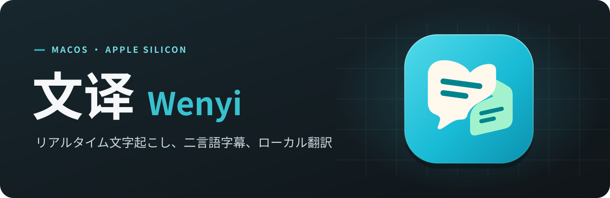
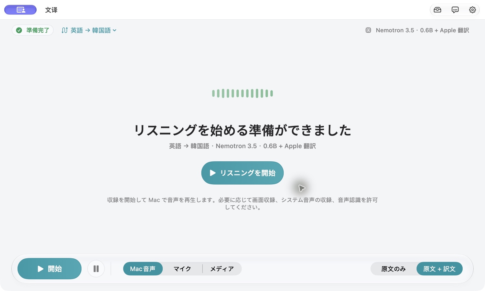

**1.16.12（ビルド 1283）** では、メディアの既定値を端末内 Nemotron と Index オンライン翻訳に設定しました。フローティング字幕のウィンドウ幅を調整でき、保存済み記録の詳細は上揃えで表示されます。[リリースノート](docs/releases/1.16.12.md)。

**1.16.6 / build 1268：** 端末内認識・メディア字幕の翻訳に Cloudflare Workers AI を追加しました。Account ID、Token、モデルを個別に設定し、サービスのロゴを同梱します。[設定と検証範囲](docs/cloudflare-workers-ai.md)。

**Build 1267：** Azure／MAI、Nari、Jev の連携を一時停止し、設定項目を削除しました。旧バージョンの設定手順は現在のビルドには適用されません。[詳細](docs/paused-integrations.md)。

<p align="center">
  <a href="#インストールと設定"></a>
</p>

<p align="center">
  <a href="./README.md">English</a> · <a href="./README.zh-CN.md">简体中文</a> · <strong>日本語</strong>
</p>

<p align="center">
  
  
  
</p>

<p align="center">
  <strong>Apple Silicon</strong> · macOS 14 以降 · macOS 27 対応 · 1.16.12（ビルド 1283）
</p>

<p align="center">
  <a href="https://github.com/ripvanmickey/WenyiTranslator/releases/latest">DMG をダウンロード</a> ·
  <a href="https://ripvanmickey.github.io/WenyiTranslator/ja/">製品紹介</a> ·
  <strong><a href="#インストールと設定">インストールと設定</a></strong> ·
  <a href="#リアルタイム字幕とローカル翻訳">機能</a> ·
  <a href="#ローカルビルド">ローカルビルド</a>
</p>

文訳（Wenyi）は、Mac のシステム音声やマイク入力をリアルタイムで文字起こしします。動画、ポッドキャスト、会議などで原文と訳文を同時に表示でき、文字起こしを保存して編集することもできます。



## アプリの表示言語

**設定 → 一般** の下部にある **アプリの言語** で、日本語、英語、簡体字中国語、またはシステムの言語を選ぶと、表示言語がすぐに切り替わります。字幕の原文と訳文の言語は別に設定できます。


## YouTube 字幕の事前読み込みと同期

Chrome または Safari で YouTube を再生しながら、文訳で字幕を準備できます。画面下部の **メディア** を選び、**動画に接続** をクリックするか、リンクを入力します。既定では端末内 Nemotron で音声を認識し、字幕テキストを Index オンライン翻訳に送信します。初回の認識前に Nemotron モデルをダウンロードしてください。YouTube の字幕、SRT/VTT の読み込み、OpenAI・Gemini の音声認識も選べます。字幕ソース・翻訳モデル・言語が一致するキャッシュを読み込めます。音声認識を選んだ場合は、字幕準備後の AI 校正を有効にしたり、準備済みの字幕から **原文を校正** を選んだりできます。ブラウザの自動化権限と Apple Events からの JavaScript の許可が必要です。[設定と制限](./docs/VIDEO-SUBTITLE-PRELOAD.zh-CN.md)をご覧ください。

## リアルタイム字幕とローカル翻訳

### リアルタイム文字起こしとフローティング字幕

Mac のシステム音声やマイク入力を取り込み、字幕をリアルタイムで表示します。翻訳に対応するモードでは、メインウインドウの右下で **原文のみ** または **原文 + 訳文** を選べます。左上の言語ペアをクリックすると字幕の言語を変更できます。フローティング字幕には個別の表示設定があります。macOS 26 以降では、下部の操作バーに Liquid Glass を使用します。Core Audio Tap によるシステム音声のみの取り込みには macOS 14.2 以降が必要です。

### ローカル音声認識と発話区間の検出

**設定 → 一般** の **ローカルモード** で、Nemotron 0.6B、Qwen3-ASR、実験的な複数話者認識を選べます。認識エンジンの横にある歯車から、モデルのダウンロード、ファイル検証、読み込み、削除ができます。Nemotron と Qwen3-ASR は音声区間検出（VAD）を使用します。Apple Speech と Apple のシステム翻訳には macOS 26 以降が必要です。

### LM Studio によるローカル翻訳

**ローカルモード** でローカルモデル翻訳を選び、同じ Mac 上の LM Studio に接続します。Index-Translate 9B のプリセットを使うか、サーバーの一覧からモデルを選べます。設定画面から短文・長文のテストと遅延診断を実行できます。ローカル認識とローカル翻訳を選ぶと、音声と字幕は Mac 上で処理されます。

### Index オンライン翻訳

**設定 → 一般 → 処理モード** で **Index オンライン翻訳** を選びます。音声認識は Mac 上で行い、翻訳対象の字幕テキストは Bilibili の Index-Translate API に送信されます。接続先は設定済みです。

## 謝辞

翻訳 API を無料で公開してくださっている Bilibili の [Index-Translate チーム](https://github.com/bilibili/Index-Translate#inference)に感謝します。Index オンライン翻訳では、音声認識は Mac 内で行い、翻訳対象の字幕テキストだけを Bilibili に送信します。初回インストール時の音声認識エンジンは Nemotron です。ローカルモードと Index オンライン翻訳のどちらでも、音声認識エンジンの選択とモデルの管理ができます。

## 保存した文字起こし

文字起こしを保存、編集、改名し、対応する TXT ファイルを Finder で表示できます。ローカル翻訳モデルを設定すると、句読点の補完、段落分け、タイトルの提案にも使えます。

## インストールと設定

[GitHub Releases](https://github.com/ripvanmickey/WenyiTranslator/releases/latest) から ARM64 版の DMG を入手できます。Apple Silicon（M1 以降）と macOS 14.0 以降が必要です。macOS 27 にも対応しています。

1. DMG を開いて文译を「アプリケーション」にドラッグします。
2. 「設定 → 一般」でローカルモードと音声認識エンジンを選びます。必要なモデルをダウンロードし、音声入力に応じた権限を許可します。
3. 翻訳する場合は LM Studio でテキストモデルを読み込み、ローカル API を起動します。文译でサービスのアドレス（例 `http://localhost:1235/v1`）を入力し、モデル一覧から実際のモデル ID を選びます。認証を有効にしている場合はキーも入力します。「処理モード」で Index オンライン翻訳を選ぶ場合、LM Studio や API キーの設定は不要です。
4. 翻訳をテストし、原文と訳文の言語を選んでセッションを開始します。文字起こしだけを使う場合は原文のみの出力を選びます。

配布パッケージはアドホック署名を使用しており、Apple の公証は未取得です。

## ローカルビルド

Apple Silicon Mac、Swift 6.2 ツールチェーン、macOS 26 の API を含む SDK を使用します。DMG の作成には Xcode 27 を使用します。アプリのデプロイメントターゲットは macOS 14 です。

```sh
git clone https://github.com/ripvanmickey/WenyiTranslator.git
cd WenyiTranslator
swift build -c release
```

Swift のメイン実行ファイルは単独でビルドできます。完全なインストーラを作るには、Python/MLX 実行環境と複数話者認識用の ARM64 ライブラリも必要です。

| 項目 | 場所 |
| --- | --- |
| 同梱する Swift 依存ライブラリと出典 | [Vendor/PROVENANCE.md](./Vendor/PROVENANCE.md) |
| CPython 依存パッケージのバージョン | [Resources/ASRRuntime/](./Resources/ASRRuntime/) 内の `requirements-*.txt` |
| macOS 14 用 MLX wheel の配布元とチェックサム | [macos14-wheels.json](./Resources/ASRRuntime/macos14-wheels.json) |
| 実行環境の準備 | [bundle_asr_runtime.py](./script/bundle_asr_runtime.py)、[prepare_macos14_mlx.py](./script/prepare_macos14_mlx.py) |
| 複数話者認識のネイティブライブラリ | [Resources/MultitalkerNative/](./Resources/MultitalkerNative/) にライセンス情報を掲載。パッケージ作成前に macOS 14 を対象とした汎用 ARM64 ライブラリを用意します。 |
| DMG 作成、コンポーネント検査、ローカル署名 | [build_local_dmg.sh](./script/build_local_dmg.sh) |

新しい開発環境では、パッケージ作成前にランタイムとライブラリを手動で用意します。ディスクイメージの作成サービスも必要です。

## 検証状況と制限

ビルド 1283 は、署名と 156 個のネイティブコンポーネントの最低 OS バージョン検査に合格しました。メディアの既定値と既存の字幕キャッシュの読み込みを検証しました。macOS 14 の実機起動は未検証です。

```sh
bash script/verify_caption_context_correction.sh
bash script/verify_reasoning_compatibility.sh
bash script/verify_joint_japanese_translation.sh
bash script/verify_transcript_polish.sh
bash script/verify_transcript_rename.sh
```

## 出典とライセンス

文訳（Wenyi）は himomohi が開発した [AirTranslate 1.16.0](https://github.com/himomohi/AirTranslate) をベースに開発しており、上流の [Apache-2.0 ライセンス](./LICENSE) と [NOTICE](./NOTICE) を保持しています。[Swift SDK](./Vendor/PROVENANCE.md)、[音声認識ランタイム](./Resources/ASR-Runtime-Notices.md)、[livecaption のソース](./Resources/ASRProject/UPSTREAM.txt)、[複数話者認識コンポーネント](./Resources/MultitalkerNative/THIRD-PARTY-LICENSES.md) の詳細は各資料を参照してください。livecaption ソース単体のライセンスは確認中です。
