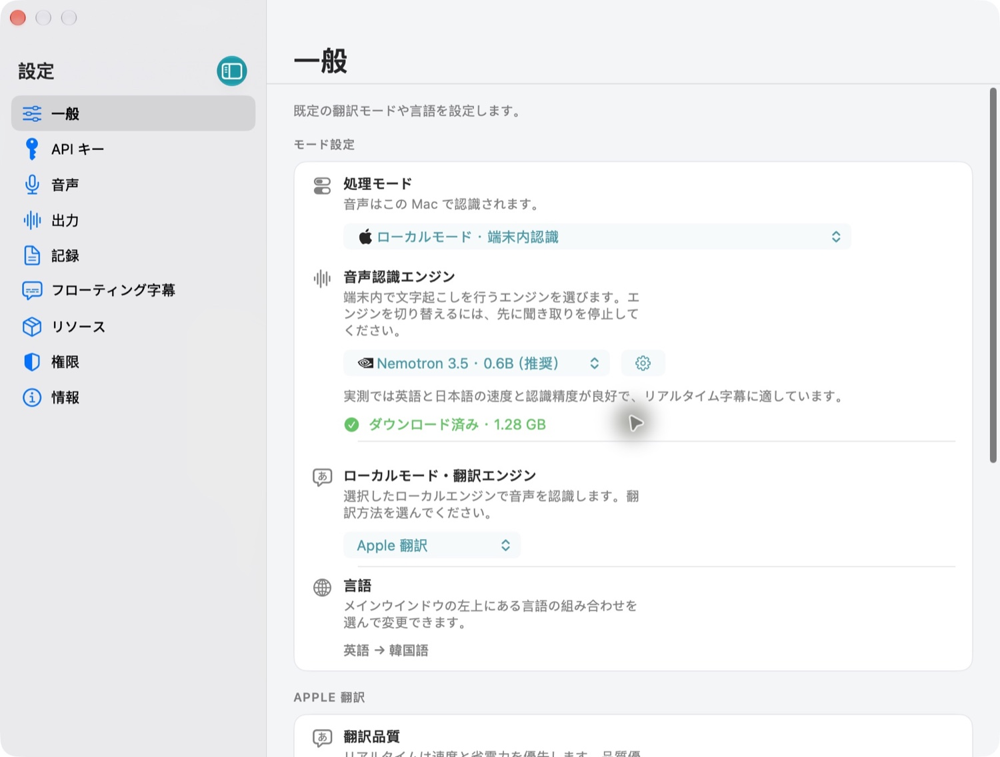

<p align="center">
  <a href="#インストールと設定"></a>
</p>

<p align="center">
  <a href="./README.md">English</a> · <a href="./README.zh-CN.md">简体中文</a> · <strong>日本語</strong>
</p>

<p align="center">
  
  
  
</p>

<p align="center">
  <strong>Apple Silicon</strong> · macOS 14 以降 · 1.16.0（ビルド 1223）
</p>

<p align="center">
  <a href="./docs/wenyi.html">製品紹介（中国語）</a> ·
  <strong><a href="#インストールと設定">インストールと設定</a></strong> ·
  <a href="#リアルタイム字幕とローカル翻訳">機能</a> ·
  <a href="#ローカルビルド">ローカルビルド</a>
</p>

文译（Wenyi）は、Mac のシステム音声やマイク入力をリアルタイムで文字起こしします。動画、ポッドキャスト、会議などで原文と訳文を同時に表示でき、文字起こしを保存して編集することもできます。

## アプリの表示言語

**設定 → 一般 → アプリの言語** で、日本語、英語、簡体字中国語、またはシステムの言語を選ぶと、表示言語がすぐに切り替わります。字幕の原文と訳文の言語は別に設定できます。



## リアルタイム字幕とローカル翻訳

### リアルタイム文字起こしとフローティング字幕

システム音声やマイク入力を取り込み、発話に合わせて原文を表示します。翻訳を有効にすると、メインウインドウやフローティングウインドウで訳文のみ、または原文と訳文の両方を表示できます。Core Audio Tap によるシステム音声のみの取り込みには macOS 14.2 以降が必要です。

### ローカル音声認識と発話区間の検出

Nemotron 0.6B、Qwen3-ASR、実験的な複数話者認識に対応しています。アプリ内で認識モデルのダウンロード、読み込み、削除ができます。Nemotron と Qwen3-ASR は認識時に音声区間検出（VAD）を使用します。Apple Speech と Apple のシステム翻訳には macOS 26 以降が必要です。

### LM Studio によるローカル翻訳

認識したテキストを同じ Mac 上の LM Studio に送って翻訳します。設定画面では短文・長文の翻訳テストと字幕の遅延診断を利用できます。ローカル認識とローカル翻訳を選ぶと、音声とテキストの処理は Mac 上で完結します。

ビルド 1202 では、**後続の文脈を使った字幕の訂正**を追加しました。翻訳処理に余裕があるときに、後続の発話を参考に確定済みの字幕を見直し、同音異義語の誤認識を訂正できる場合は原文と訳文を一緒に更新します。新しい字幕の処理が優先されます。この機能は「設定 → 一般」で無効にできます。

ビルド 1203 では、ローカルの日中翻訳で訳文に仮名が残った場合、その区間の翻訳だけを一度やり直します。正常な訳文は引き続き逐次表示されます。

ビルド 1205 では、ローカル翻訳の設定から Index-Translate 9B を選択できます。使用するには LM Studio でモデルをダウンロードして、ローカル API を有効にしてください。

ビルド 1206 では、メインウインドウとフローティング字幕のローカル処理で、最初の字幕を表示し、確定時に一度だけ更新します。

ビルド 1207 では、ローカル字幕を確定前にも順次表示します。短い訳文もすぐに表示し、確定時に全文を反映します。

ビルド 1208 では、次の訳文が出るまで直前の訳文をフローティング字幕に残し、ローカル翻訳の状態を表示します。

ビルド 1209 では、メインウインドウを上にスクロールして過去の字幕を読み込めます。訳文のエスケープされた改行を修正し、日中翻訳から固有名詞専用の指示と直前の対訳字幕の参照を削除しました。

ビルド 1210 では、Nemotron が日本語の句読点で発話を区切り、文が続く可能性が高い場合は確定を少し遅らせます。

ビルド 1211 では、Index-Translate の日中字幕プレビューに前後の原文を含めません。複数に分割された短い字幕は、確定時に全体を翻訳します。

ビルド 1213 では「設定 → 一般 → 処理モード」で、ローカルモードと並んで Index オンライン翻訳を選択できます。音声認識は Mac 内で行い、翻訳対象の字幕テキストだけを Bilibili に送信します。

ビルド 1214 では、通常の長さの字幕をまとめて送信します。配信の中断、出力の打ち切り、日本語から中国語への翻訳で原文が返った場合には、条件に応じて一度だけ再試行します。

ビルド 1216 では Granite Speech と専用の実行環境を削除しました。以前 Granite を選択していた場合は Nemotron に切り替わります。

ビルド 1217 では、配布用 Python ランタイムから未使用の pip コードと一部のテスト・文書を削除しました。

## 謝辞

翻訳 API を無料で公開してくださっている Bilibili の [Index-Translate チーム](https://github.com/bilibili/Index-Translate#inference)に感謝します。Index オンライン翻訳では、音声認識は Mac 内で行い、翻訳対象の字幕テキストだけを Bilibili に送信します。音声認識モデルはローカルモードで管理できます。

## 保存した文字起こし

文字起こしを保存、編集、改名し、対応する TXT ファイルを Finder で表示できます。ローカル翻訳モデルを設定すると、句読点の補完、段落分け、タイトルの提案にも使えます。

## インストールと設定

Apple Silicon（M1 以降）と macOS 14.0 以降が必要です。このリポジトリにはソースコードを掲載しており、テスト用インストーラは別途配布しています。

1. DMG を開いて文译を「アプリケーション」にドラッグします。ZIP の場合は展開してから移動します。
2. 「設定 → 一般」でローカルモードと音声認識エンジンを選びます。必要なモデルをダウンロードし、音声入力に応じた権限を許可します。
3. 翻訳する場合は LM Studio でテキストモデルを読み込み、ローカル API を起動します。文译でサービスのアドレス（例 `http://localhost:1235/v1`）を入力し、モデル一覧から実際のモデル ID を選びます。認証を有効にしている場合はキーも入力します。「処理モード」で Index オンライン翻訳を選ぶ場合、LM Studio や API キーの設定は不要です。
4. 翻訳をテストし、原文と訳文の言語を選んでセッションを開始します。文字起こしだけを使う場合は原文のみの出力を選びます。

テスト用パッケージはローカルのアドホック署名を使用しており、Apple の公証は未取得です。

## ローカルビルド

Apple Silicon Mac、Swift 6.2 ツールチェーン、macOS 26 の API を含む SDK を使用します。アプリのデプロイメントターゲットは macOS 14 です。

```sh
git clone https://github.com/ripvanmickey/WenyiTranslator.git
cd WenyiTranslator
swift build -c release
```

Swift のメイン実行ファイルは単独でビルドできます。完全なインストーラを作るには、Python/MLX 実行環境と複数話者認識用の ARM64 ライブラリも必要です。

| 項目 | 場所 |
| --- | --- |
| 同梱する Swift 依存ライブラリと出典 | [Vendor/PROVENANCE.md](./Vendor/PROVENANCE.md) |
| CPython 依存パッケージのバージョン | [Resources/ASRRuntime/](./Resources/ASRRuntime/) 内の `requirements-*.txt` |
| macOS 14 用 MLX wheel の配布元とチェックサム | [macos14-wheels.json](./Resources/ASRRuntime/macos14-wheels.json) |
| 実行環境の準備 | [bundle_asr_runtime.py](./script/bundle_asr_runtime.py)、[prepare_macos14_mlx.py](./script/prepare_macos14_mlx.py) |
| 複数話者認識のネイティブライブラリ | [Resources/MultitalkerNative/](./Resources/MultitalkerNative/) にライセンス情報を掲載。パッケージ作成前に macOS 14 を対象とした汎用 ARM64 ライブラリを用意します。 |
| DMG 作成、コンポーネント検査、ローカル署名 | [build_local_dmg.sh](./script/build_local_dmg.sh) |

新しい開発環境では、パッケージ作成前にランタイムとライブラリを手動で用意します。ディスクイメージの作成サービスも必要です。

## 検証状況と制限

ビルド 1202 は、コンパイル、署名、DMG の整合性検証、296 個のネイティブコンポーネントの macOS 14 最低バージョン検査に合格しました。文脈を使った訂正は模擬サービスで検証済みです。実際の日本語会話での精度と遅延、および macOS 14 を搭載した M1 Mac 上での一連の動作は未検証です。

```sh
bash script/verify_caption_context_correction.sh
bash script/verify_reasoning_compatibility.sh
bash script/verify_joint_japanese_translation.sh
bash script/verify_transcript_polish.sh
bash script/verify_transcript_rename.sh
```

## 出典とライセンス

文译は [AirTranslate 1.16.0](https://github.com/himomohi/AirTranslate) をベースに開発しており、上流の [Apache-2.0 ライセンス](./LICENSE) と [NOTICE](./NOTICE) を保持しています。[Swift SDK](./Vendor/PROVENANCE.md)、[音声認識ランタイム](./Resources/ASR-Runtime-Notices.md)、[livecaption のソース](./Resources/ASRProject/UPSTREAM.txt)、[複数話者認識コンポーネント](./Resources/MultitalkerNative/THIRD-PARTY-LICENSES.md) の詳細は各資料を参照してください。livecaption ソース単体のライセンスは確認中です。
