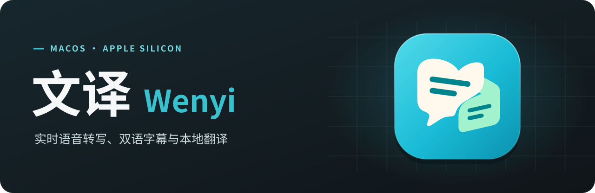

<p align="center">
  <a href="#installation-and-setup"></a>
</p>

<p align="center">
  <strong>English</strong> · <a href="./README.zh-CN.md">简体中文</a> · <a href="./README.ja.md">日本語</a>
</p>

<p align="center">
  
  
  
</p>

<p align="center">
  <strong>Apple Silicon</strong> · macOS 14+ · 1.16.0 (build 1213)
</p>

<p align="center">
  <strong><a href="#installation-and-setup">Installation and setup</a></strong> ·
  <a href="#live-captions-and-local-translation">Features</a> ·
  <a href="#build-locally">Build locally</a>
</p>

Wenyi turns Mac system audio or microphone input into live captions. Display the original and translated text together while watching a video, listening to a podcast, or joining a meeting, then save the transcript for editing.

## Live captions and local translation

### Live transcription and floating captions

Capture system audio or microphone input and follow the transcript as people speak. With translation enabled, show the translation alone or both languages in the main or floating window. Audio-only system capture via Core Audio Tap requires macOS 14.2 or later.

### Local speech recognition and segmentation

Choose Nemotron 0.6B, Granite Speech 2B, Qwen3-ASR, or experimental multi-speaker recognition. Download, import, or delete recognition models within the app. Nemotron and Qwen3-ASR offer voice activity detection (VAD) presets and custom settings that apply the next time a session starts. Apple Speech and Apple system translation require macOS 26 or later.

### Local translation with LM Studio

Wenyi sends the recognized text to LM Studio on the same Mac. The settings include short- and long-sentence translation tests and caption latency diagnostics. With local recognition and local translation selected, audio and text are processed on your Mac.

Build 1202 adds **contextual caption correction**. While translation is idle, Wenyi uses later speech to check recent finalized captions for homophone mistakes and updates the original and translation together when it finds a correction. New captions take priority. You can turn this feature off under Settings → General.

Build 1203 checks local Japanese-to-Chinese subtitles for leftover kana and retries the affected segment once with a translation-only request. Valid subtitles still stream as before.

Build 1205 adds an Index-Translate 9B preset to local translation settings. Download the model in LM Studio and enable the local API to use it.

Build 1206 keeps the first visible local caption on screen and updates it once the segment is confirmed, in both the main window and floating captions.

Build 1207 restores incremental local subtitle previews. Short translations appear immediately, and the preview grows at a controlled rate until confirmation.

Build 1208 keeps the previous floating translation visible until a replacement arrives and labels local translations as preview, complete, or interrupted.

Build 1209 loads older captions as you scroll up in the main window, renders escaped line breaks as new lines, and removes the earlier bilingual references and dedicated naming instructions from local Japanese-to-Chinese translation.

Build 1210 recognizes Japanese sentence-final punctuation in Nemotron and allows a brief extra pause after common unfinished clauses.

Build 1211 stops sending adjacent source fragments with Index-Translate Japanese-to-Chinese subtitle requests. Short multi-block captions receive one complete translation when confirmed.

In build 1213, Index online translation appears alongside Local Mode under Settings → General → Processing Mode. Speech recognition stays on the Mac, and only the current caption text is sent to Bilibili for translation.

## Saved transcripts

Save, edit, or rename transcripts and reveal the corresponding TXT files in Finder. A configured local translation model can restore punctuation, split text into paragraphs, or suggest a title.

## Installation and setup

Requires Apple Silicon (M1 or later) and macOS 14.0 or later. This repository hosts the source code. Test installers are distributed separately.

1. Open the DMG and drag Wenyi into Applications. If you have the ZIP, extract it and move the app into Applications.
2. In Settings → General, select local mode and a speech recognition engine. Download the model when prompted and grant the permissions required by your audio source.
3. For translation, load a text model in LM Studio and start its local API. In Wenyi, enter the service address, such as `http://localhost:1235/v1`, fetch the model list, and choose the model ID shown there. Enter a key if the local server requires authentication. Alternatively, select Index online translation under Processing Mode. It requires neither LM Studio nor an API key.
4. Test translation, choose the source and target languages, and start listening. Select original-only output for transcription.

The test packages use a local ad hoc signature and have yet to be notarized by Apple.

## Build locally

Use an Apple Silicon Mac, the Swift 6.2 toolchain, and an SDK that includes macOS 26 APIs. The app deployment target is macOS 14.

```sh
git clone https://github.com/ripvanmickey/WenyiTranslator.git
cd WenyiTranslator
swift build -c release
```

The main Swift executable builds independently. A complete installer also needs the Python/MLX runtime and ARM64 libraries for multi-speaker recognition.

| Item | Location |
| --- | --- |
| Vendored Swift dependencies and provenance | [Vendor/PROVENANCE.md](./Vendor/PROVENANCE.md) |
| CPython dependency versions | `requirements-*.txt` in [Resources/ASRRuntime/](./Resources/ASRRuntime/) |
| macOS 14 MLX wheels and checksums | [macos14-wheels.json](./Resources/ASRRuntime/macos14-wheels.json) |
| Runtime setup | [bundle_asr_runtime.py](./script/bundle_asr_runtime.py), [prepare_macos14_mlx.py](./script/prepare_macos14_mlx.py) |
| Multi-speaker native libraries | License information in [Resources/MultitalkerNative/](./Resources/MultitalkerNative/). Provide generic ARM64 libraries targeting macOS 14 for packaging. |
| DMG packaging, component checks, and local signing | [build_local_dmg.sh](./script/build_local_dmg.sh) |

On a fresh development Mac, prepare the runtime and libraries manually before packaging. The packaging script also needs working disk image services.

## Verification and limits

Build 1202 passed compilation, signature and DMG integrity checks, and macOS 14 minimum-version checks for 296 native components. Contextual correction passed tests with a simulated service. Correction accuracy and latency in real Japanese conversations, and end-to-end behavior on an M1 Mac running macOS 14, remain to be tested.

```sh
bash script/verify_caption_context_correction.sh
bash script/verify_reasoning_compatibility.sh
bash script/verify_joint_japanese_translation.sh
bash script/verify_transcript_polish.sh
bash script/verify_transcript_rename.sh
```

## Credits and licensing

Wenyi is based on [AirTranslate 1.16.0](https://github.com/himomohi/AirTranslate) and retains its [Apache-2.0 license](./LICENSE) and [NOTICE](./NOTICE). See the separate notices for the [Swift SDKs](./Vendor/PROVENANCE.md), [ASR runtime](./Resources/ASR-Runtime-Notices.md), [livecaption source](./Resources/ASRProject/UPSTREAM.txt), and [multi-speaker components](./Resources/MultitalkerNative/THIRD-PARTY-LICENSES.md). The standalone license for the livecaption source still needs confirmation.
