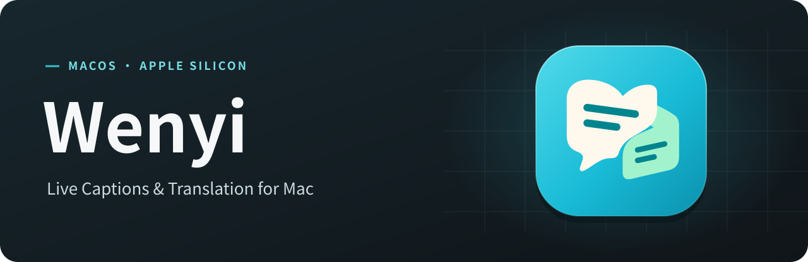
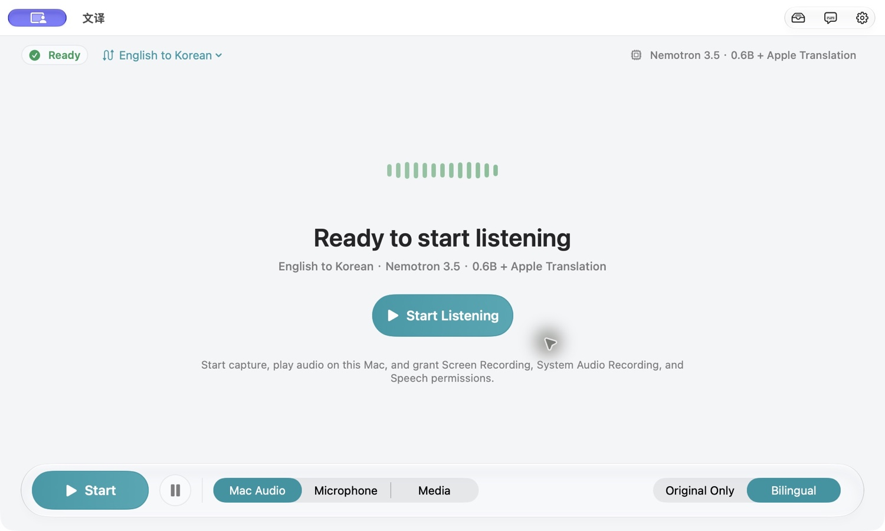
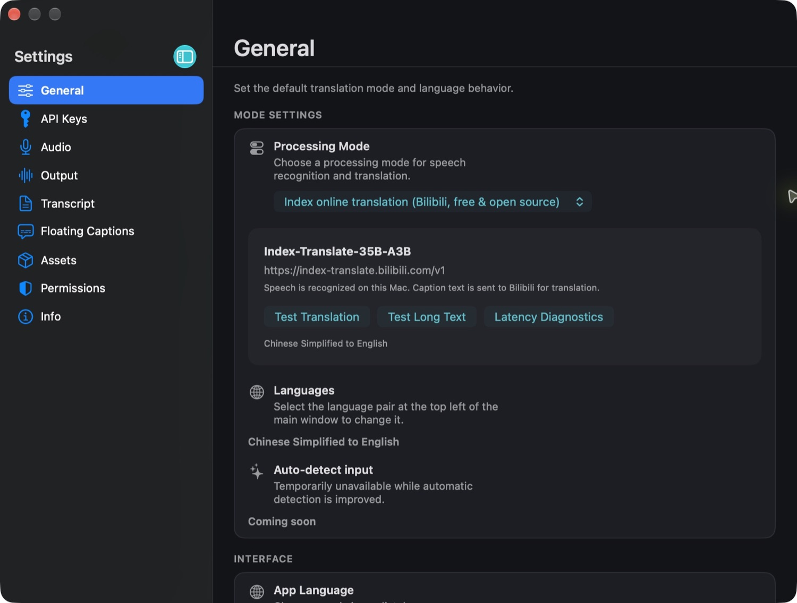

<p align="center">
  <a href="#installation-and-setup"></a>
</p>

<p align="center">
  <strong>English</strong> · <a href="./README.zh-CN.md">简体中文</a> · <a href="./README.ja.md">日本語</a>
</p>

<p align="center">
  
  
  
</p>

<p align="center">
  <strong>Apple Silicon</strong> · macOS 14+ · macOS 27 supported · 1.16.4 (build 1249)
</p>

<p align="center">
  <a href="https://github.com/ripvanmickey/WenyiTranslator/releases/latest">Download DMG</a> ·
  <a href="https://ripvanmickey.github.io/WenyiTranslator/en/">Product overview</a> ·
  <strong><a href="#installation-and-setup">Installation and setup</a></strong> ·
  <a href="#live-captions-and-local-translation">Features</a> ·
  <a href="#build-locally">Build locally</a>
</p>

Wenyi turns Mac system audio or microphone input into live captions. Display the original and translated text together while watching a video, listening to a podcast, or joining a meeting, then save the transcript for editing.



## App language

Choose **English**, **日本語**, **简体中文**, or **System** under **Settings → General → App Language** at the bottom of the page, and the interface updates immediately. The source and target languages for captions are set separately.



## YouTube subtitle preloading

Keep watching YouTube in Chrome or Safari while Wenyi prepares timed captions. Open **Video Subtitle Preloading** from the main window, paste the video URL, and select the languages. Matching local caches load automatically; complete caches need no download or translation, and **Fill Missing Captions** resumes only unfinished translations. Use existing YouTube captions, import SRT/VTT, or explicitly choose OpenAI audio transcription (audio upload and API usage apply). Chrome pause, seek and 2× playback synchronization were tested on macOS 27. Browser automation permission and JavaScript from Apple Events must be enabled. See the [setup and limitations](./docs/VIDEO-SUBTITLE-PRELOAD.zh-CN.md).

## Live captions and local translation

### Live transcription and floating captions

Capture Mac system audio or microphone input and follow the transcript as people speak. Choose **Original Only** or **Original + Translation** at the bottom right of the main window when both are available. Click the language pair at the upper left to change the source or target language. Floating captions have their own display settings. The bottom control bar uses Liquid Glass on macOS 26 and later. Audio-only system capture via Core Audio Tap requires macOS 14.2 or later.

### Local speech recognition and segmentation

In **Settings → General → Local Mode**, choose Nemotron 0.6B, Qwen3-ASR, or experimental multi-speaker recognition. Use the gear next to the recognition engine to open model management for downloads, file verification, importing, and deletion. Nemotron and Qwen3-ASR use voice activity detection (VAD). Apple Speech and Apple system translation require macOS 26 or later.

### Local translation with LM Studio

In **Local Mode**, select **Local Model Translation** and connect to LM Studio on the same Mac. Load the Index-Translate 9B preset or select an available model from the server. The settings include short- and long-sentence tests and latency diagnostics. Local speech recognition and local translation process audio and captions on your Mac.

### Index Online Translation

Choose **Index Online Translation** under **Settings → General → Processing Mode**. Wenyi recognizes speech on your Mac and sends the caption text to Bilibili’s Index-Translate API. The service is preconfigured.

## Acknowledgments

Thanks to Bilibili’s [Index-Translate team](https://github.com/bilibili/Index-Translate#inference) for making its translation API available for free. In Index Online Translation mode, Wenyi recognizes speech on your Mac and sends caption text to Bilibili for translation. Nemotron is the default recognition engine for new installations. Choose an engine or manage its model in either Local Mode or Index Online Translation.

## Saved transcripts

Save, edit, or rename transcripts and reveal the corresponding TXT files in Finder. A configured local translation model can restore punctuation, split text into paragraphs, or suggest a title.

## Installation and setup

Download the ARM64 DMG from [GitHub Releases](https://github.com/ripvanmickey/WenyiTranslator/releases/latest). Wenyi requires Apple Silicon (M1 or later) and macOS 14.0 or later, including macOS 27.

1. Open the DMG and drag Wenyi into Applications.
2. In Settings → General, select local mode and a speech recognition engine. Download the model when prompted and grant the permissions required by your audio source.
3. For translation, load a text model in LM Studio and start its local API. In Wenyi, enter the service address, such as `http://localhost:1235/v1`, fetch the model list, and choose the model ID shown there. Enter a key if the local server requires authentication. Alternatively, select Index online translation under Processing Mode. It requires neither LM Studio nor an API key.
4. Test translation, choose the source and target languages, and start listening. Select original-only output for transcription.

The DMG contains an ad hoc signed app. Apple notarization is pending.

## Build locally

Use an Apple Silicon Mac, the Swift 6.2 toolchain, and an SDK that includes macOS 26 APIs. DMG packaging uses Xcode 27. The app deployment target is macOS 14.

```sh
git clone https://github.com/ripvanmickey/WenyiTranslator.git
cd WenyiTranslator
swift build -c release
```

The main Swift executable builds independently. A complete installer also needs the Python/MLX runtime and ARM64 libraries for multi-speaker recognition.

| Item | Location |
| --- | --- |
| Vendored Swift dependencies and provenance | [Vendor/PROVENANCE.md](./Vendor/PROVENANCE.md) |
| CPython dependency versions | `requirements-*.txt` in [Resources/ASRRuntime/](./Resources/ASRRuntime/) |
| macOS 14 MLX wheels and checksums | [macos14-wheels.json](./Resources/ASRRuntime/macos14-wheels.json) |
| Runtime setup | [bundle_asr_runtime.py](./script/bundle_asr_runtime.py), [prepare_macos14_mlx.py](./script/prepare_macos14_mlx.py) |
| Multi-speaker native libraries | License information in [Resources/MultitalkerNative/](./Resources/MultitalkerNative/). Provide generic ARM64 libraries targeting macOS 14 for packaging. |
| DMG packaging, component checks, and local signing | [build_local_dmg.sh](./script/build_local_dmg.sh) |

On a fresh development Mac, prepare the runtime and libraries manually before packaging. The packaging script also needs working disk image services.

## Verification and limits

Build 1249 passed signature, archive integrity and minimum macOS checks for 156 native components. Automatic cache loading was verified on macOS 27.2.1. Chrome playback synchronization was tested with the preceding build. macOS 14 startup, Safari synchronization, ads and the full OpenAI audio workflow still need separate testing.

```sh
bash script/verify_caption_context_correction.sh
bash script/verify_reasoning_compatibility.sh
bash script/verify_joint_japanese_translation.sh
bash script/verify_transcript_polish.sh
bash script/verify_transcript_rename.sh
```

## Credits and licensing

Wenyi is based on himomohi’s [AirTranslate 1.16.0](https://github.com/himomohi/AirTranslate) and retains its [Apache-2.0 license](./LICENSE) and [NOTICE](./NOTICE). See the separate notices for the [Swift SDKs](./Vendor/PROVENANCE.md), [ASR runtime](./Resources/ASR-Runtime-Notices.md), [livecaption source](./Resources/ASRProject/UPSTREAM.txt), and [multi-speaker components](./Resources/MultitalkerNative/THIRD-PARTY-LICENSES.md). The standalone license for the livecaption source still needs confirmation.
