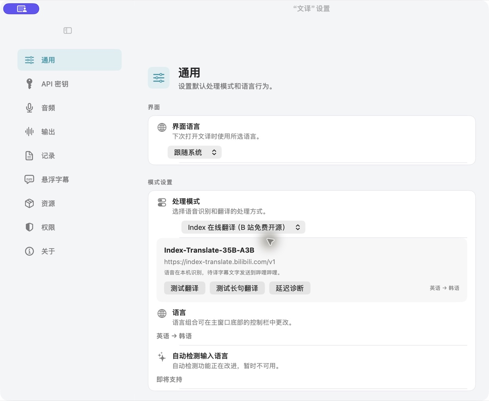

<p align="center">
  <a href="#安装与配置"></a>
</p>

<p align="center">
  <a href="./README.md">English</a> · <strong>简体中文</strong> · <a href="./README.ja.md">日本語</a>
</p>

<p align="center">
  
  
  
</p>

<p align="center">
  <strong>Apple Silicon</strong> · macOS 14+ · 支持 macOS 27 · 1.16.0（构建 1238）
</p>

<p align="center">
  <a href="https://github.com/ripvanmickey/WenyiTranslator/releases/latest">下载 DMG</a> ·
  <a href="./docs/wenyi.html">产品介绍</a> ·
  <strong><a href="#安装与配置">安装与配置</a></strong> ·
  <a href="#实时字幕与本地翻译">查看功能</a> ·
  <a href="#本地构建">本地构建</a>
</p>

文译可以把 Mac 正在播放的声音或麦克风语音转成实时字幕。看外语视频、听播客或开会时，可以同时显示原文和译文，也可以将转写保存下来继续编辑。

## 界面语言

在「**设置 → 通用 → 界面语言**」选择英语、日语、简体中文或跟随系统，界面会立即更新。字幕的原文和译文语言可单独设置。



## 实时字幕与本地翻译

### 实时转写与悬浮字幕

从 Mac 系统音频或麦克风采集语音，实时显示原文。启用翻译后，可以单独看译文，也可以在主窗口或悬浮窗口同时看原文和译文。纯系统音频 Tap 需要 macOS 14.2 或以上。

### 本地识别与断句

支持 Nemotron 0.6B、Qwen3-ASR，以及实验性的多人识别。识别模型可在应用内按需下载、导入和删除。Nemotron 和 Qwen3-ASR 在识别时使用语音活动检测（VAD）。Apple Speech 和 Apple 系统翻译需要 macOS 26 或以上。

### LM Studio 本地翻译

文译把识别出的文本发送给同一台 Mac 上的 LM Studio 服务，可以在设置中测试短句和长句翻译，并查看字幕延迟诊断。在本地识别与本地翻译的组合下，音频和字幕处理都在本机完成。

构建 1202 加入了**跨段回看纠错**。翻译空闲时，文译依据后文尝试纠正近期已确认字幕中的同音词，并一起更新对应译文。新字幕到来时优先处理新内容。此功能可在「设置 → 通用」关闭。

构建 1203 检查本地日译中字幕是否残留假名。发现残留时，仅重译受影响的片段一次。正常译文照常流式显示。

构建 1205 在本地翻译设置中加入 Index-Translate 9B 选项。使用前请在 LM Studio 下载该模型并开启本地 API。

构建 1206 的本地翻译字幕在主窗口和悬浮窗口均先显示首个可用结果，确认后更新一次。

构建 1207 恢复本地字幕的逐步预览，短译文也会立即显示，确认时补齐完整文字。

构建 1208 在新译文出现前保留上一段悬浮译文，并标记本地译文的预览、完成及中断状态。

构建 1209 支持在主窗口向上滚动时分批加载历史字幕，将译文中的转义换行显示为实际换行，并撤掉本地日译中的专名提示和前段双语参考。

构建 1210 让 Nemotron 使用日语句末标点，并对常见未完句尾稍微延后确认。

构建 1211 的 Index-Translate 日译中预览按块翻译，省去相邻原文参考。分过块的短字幕在确认后整段翻译一次。

构建 1213 将「Index 在线翻译（B 站免费开源）」移到「设置 → 通用 → 处理模式」，与「本地模式」并列。语音在本机识别，只有当前待译字幕文字会发送到哔哩哔哩。

构建 1214 将常见长度的在线字幕整段提交。流式中断、输出截断或日译中回显日语时，按情况重试一次。

构建 1216 移除了 Granite Speech 及其独立运行环境。旧版选用 Granite 的设置会切到 Nemotron。

构建 1217 从安装包内的 Python 运行环境清理未使用的 pip 安装代码和部分第三方测试及文档。

## 致谢

感谢哔哩哔哩 [Index-Translate 项目](https://github.com/bilibili/Index-Translate#inference) 免费开放翻译 API。使用 Index 在线翻译时，文译在 Mac 上识别语音，只将待译字幕文本发送给哔哩哔哩。语音识别模型请在「本地模式」管理。

## 字幕记录

可以保存、编辑和重命名转写记录，在访达中定位对应的 TXT 文件。配置本地翻译模型后，还可以用它为记录补标点、分段或生成标题。

## 安装与配置

从 [GitHub Releases](https://github.com/ripvanmickey/WenyiTranslator/releases/latest) 下载 ARM64 DMG。文译支持 Apple Silicon（M1 或以上）和 macOS 14.0 或以上，包括 macOS 27。

1. 打开 DMG，把「文译」拖入「应用程序」。
2. 在「设置 → 通用」选择「本地模式」和语音识别引擎，按提示下载模型，并根据音频来源授予系统权限。
3. 需要翻译时，先在 LM Studio 加载文本模型并启动本地 API。回到文译，配置服务地址（例如 `http://localhost:1235/v1`），读取模型列表并选择实际的模型 ID。只有本地服务开启身份验证时才需要填写密钥。也可在「处理模式」直接选择「Index 在线翻译（B 站免费开源）」，无需配置 LM Studio 或密钥。
4. 点击「测试翻译」，然后选择原文和译文语言并开始监听。只看原文时可选「仅原文」。

安装包使用临时签名，Apple 公证尚未完成。

## 本地构建

使用 Apple Silicon Mac、Swift 6.2 工具链，以及包含 macOS 26 API 的 SDK。打包 DMG 使用 Xcode 27，应用的最低运行系统仍为 macOS 14。

```sh
git clone https://github.com/ripvanmickey/WenyiTranslator.git
cd WenyiTranslator
swift build -c release
```

Swift 主程序可独立编译。完整安装包还需要准备 Python/MLX 运行环境及多人识别的 ARM64 动态库。相关版本和构建脚本如下。

| 内容 | 位置 |
| --- | --- |
| Swift 依赖源码和来源说明 | [Vendor/PROVENANCE.md](./Vendor/PROVENANCE.md) |
| CPython 依赖版本 | [Resources/ASRRuntime/](./Resources/ASRRuntime/) 中的 `requirements-*.txt` |
| macOS 14 MLX wheel 来源和校验和 | [macos14-wheels.json](./Resources/ASRRuntime/macos14-wheels.json) |
| 运行环境准备 | [bundle_asr_runtime.py](./script/bundle_asr_runtime.py)、[prepare_macos14_mlx.py](./script/prepare_macos14_mlx.py) |
| 多人识别原生库 | [Resources/MultitalkerNative/](./Resources/MultitalkerNative/) 中的许可说明，打包前需提供以 macOS 14 为目标的通用 ARM64 库 |
| DMG 打包、组件检查和本地签名 | [build_local_dmg.sh](./script/build_local_dmg.sh) |

完整打包流程需要上述运行组件和可用的磁盘镜像服务。全新开发机仍需手动准备这些组件。

## 验证与限制

构建 1238 已通过签名、DMG 完整性及 156 个原生组件的最低系统版本检查，并在 macOS 27.2.1 上验证启动。M1 + macOS 14 的实际启动仍待真机验证。

```sh
bash script/verify_caption_context_correction.sh
bash script/verify_reasoning_compatibility.sh
bash script/verify_joint_japanese_translation.sh
bash script/verify_transcript_polish.sh
bash script/verify_transcript_rename.sh
```

## 来源与许可

文译基于 [AirTranslate 1.16.0](https://github.com/himomohi/AirTranslate) 开发，保留上游 [Apache-2.0 LICENSE](./LICENSE) 和 [NOTICE](./NOTICE)。第三方 SDK、运行环境及模型分别适用各自许可，详见 [Swift SDK 来源](./Vendor/PROVENANCE.md)、[ASR 运行环境说明](./Resources/ASR-Runtime-Notices.md)、[livecaption 来源](./Resources/ASRProject/UPSTREAM.txt) 和 [多人识别组件许可](./Resources/MultitalkerNative/THIRD-PARTY-LICENSES.md)。livecaption 源码的单独许可仍需确认。
